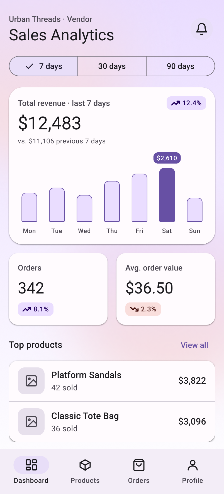
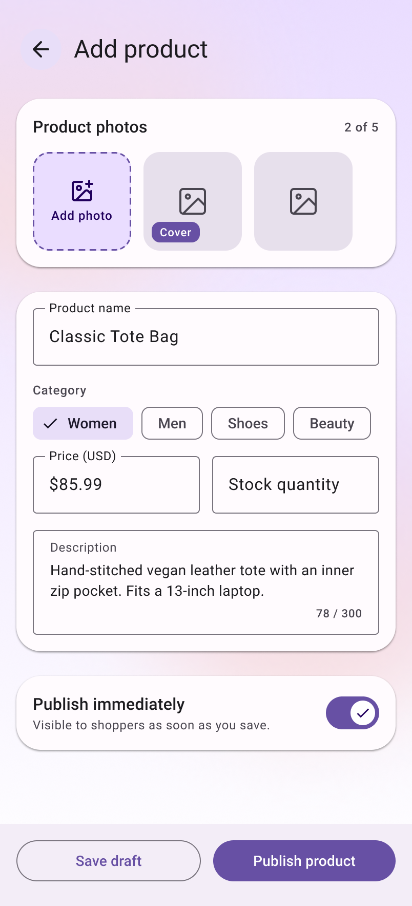

# 🛍️ Retail & E-commerce - Multi-Vendor Marketplace App

This project is currently in the **UX Research, Information Architecture, and Wireframing phase**.

---

## 👥 Team

| Member     | Primary Responsibility               |
| ---------- | ------------------------------------ |
| **Dolly**  | Shopper UX Research & Persona        |
| **Vishwa** | Vendor UX Research & Persona         |
| **Shri**   | Information Architecture & User Flow |
| **Pankaj** | Low-Fidelity Wireframes              |

> All team members will participate in design reviews, discussions, testing, and iterations.

---

## 🎯 Project Objective

The rise of Direct-to-Consumer (D2C) brands requires digital platforms that can support multiple independent sellers while maintaining a simple and trustworthy shopping experience.

Traditional e-commerce templates can become difficult to navigate when customers browse products from many different sellers.

Our goal is to design a **mobile-first multi-vendor marketplace** that provides:

### For Shoppers

* Easy product discovery
* Simple search and navigation
* Useful filtering and sorting
* Clear product information
* Transparent seller information
* Smooth cart experience

### For Vendors

* Simple product management
* Inventory management
* Clear product presentation
* Easy marketplace management
* Better customer reach

---

# 📱 Platform

The application will follow a **mobile-first approach** with design considerations for:

* iOS
* Android
* Touch-friendly interactions
* Clear navigation
* Accessible and consistent UI

---

# 🧭 Core Consumer Flow

The primary shopper journey that we will design is:

```text
Home
  ↓
Category / Search
  ↓
Product Detail Page
  ↓
Cart
```

This flow will be explored and refined during the UX process.

---

# 📋 Week 1 Scope

### UX Research - Completed 

- [x] Shopper Persona
- [x] Vendor Persona
- [x] User needs
- [x] Pain points
- [x] Goals
- [x] Initial research findings
 

### Information Architecture - Completed

- [x] Navigation hierarchy
- [x] Content structure
- [x] Marketplace categories
- [x] Core user flow


### Wireframing - Completed

- [x] Home Page
- [x] Category / Search Page
- [x] Product Detail Page
- [x] Cart Page


### Documentation

- [x] UX Markdown documentation

Figma file
- [x] Figma version: `[Week 1] UX & Wireframes`

---

# 🗂️ Planned Project Structure

```text
retail-multivendor-marketplace-ux/
│
├── README.md
│
├── docs/
│   ├── research.md
│   ├── personas.md
│   ├── information-architecture.md
│   ├── user-flow.md
│   └── wireframes.md
│
└── assets/
    ├── research/
    ├── personas/
    ├── ia/
    ├── user-flow/
    └── wireframes/
```

---

# 🎨 Design Tool

**Figma** will be used for:

* UX research documentation
* Information Architecture
* User flows
* Wireframes
* Prototyping
* UI design in later phases

**Figma File:**
[UX & Wireframes](https://www.figma.com/design/LlhKEWGpkw90UIrcOWyYDe/UX---Wireframes?node-id=0-1&p=f&t=2pMP7kbHQqrIOCkM-0)

---

# 🛠️ Tools

* Figma
* GitHub
* Markdown

---

# 📅 Project Status

**Current Phase:** 🟡 In Progress — Week 3 Hi-Fi UI

### Week 1 — UX Research, Architecture & Wireframing

**Status:** ✅ Completed

### Week 2 — Design System & Component Library

**Status:** ✅ Completed (Shripad — Material 3 system)

### Week 3 — High-Fidelity UI

**Status:** 🟡 In Progress — Vendor Dashboard completed (2026-10-23). Consumer App screens by Dolly.

The team will update this README as each deliverable is completed.

---

# 👥 Team Contributions

### Dolly

**Focus:** Shopper UX Research & Shopper Persona
Link: https://www.figma.com/board/2O5E3UJPjDJqsehTNzIDxy/Untitled?node-id=0-1&t=kv2mkC7NJM8Sr1bR-1

### Vishwa

**Focus:** Vendor UX Research & Vendor Persona
Link: https://www.figma.com/board/Xk1MjkYwOQ22HGFYusa2JW/Vendor-Persona-%E2%80%94-Multi-Vendor-Marketplace?node-id=0-1&t=RMd2eaellyra5LUb-1

### Shri

**Focus:** Information Architecture & Core User Flow
Link: https://www.figma.com/board/erAmhwLawxRCDPtujUlWlU/IA---UF?node-id=0-1&t=8LlRUGhbWwrdYhWN-1

### Pankaj

**Focus:** Low-Fidelity Wireframes
Link: https://www.figma.com/design/LlhKEWGpkw90UIrcOWyYDe/UX---Wireframes?node-id=0-1&p=f&t=2pMP7kbHQqrIOCkM-0

All members will collaborate on reviewing and refining the work.

---

## 📌 Note

This repository contains the ongoing UX/UI design work for the **Retail & E-commerce Multi-Vendor Marketplace App**.

The documentation and design artifacts will be updated throughout the project as the team progresses through each phase.


---

# 📅 Project Status

**Current Phase:** ✅ Design System & Component Library Completed

### Week 2 — Design System & Component Library (UI Kit)

**Status:** ✅ Completed

The team established the visual language of the Retail & E-commerce Multi-Vendor Marketplace App by creating a consistent and reusable design system in Figma.

### Completed Deliverables

- Defined primary, secondary, and semantic colors.
- Established a consistent typography scale for headings, body text, and captions.
- Created reusable button components with Default, Hover, and Disabled variants.
- Designed reusable input field components.
- Created reusable product card components using Auto Layout.
- Organized components using Figma Properties and Variants.
- Prepared design tokens in JSON and CSS formats for consistent design implementation.
- Organized the components and design foundations on the `04_Design System` page in Figma.
- Saved the named Figma version: `[Week 2] Design System`.
- Added the design token files to the GitHub repository.

---

# 👥 Team Contributions

### Dolly

**Focus:** Color System & Design Tokens

- Defined primary and secondary colors.
- Established semantic colors for success, warning, and error states.
- Organized color values for consistent use throughout the application.

### Vishwa

**Focus:** Typography & Input Field Components

- Defined the typography scale for headings, body text, and captions.
- Created reusable input field components.
- Maintained consistent typography and form styling.

### Shri

**Focus:** Button Components & Design System Coordination

- Created reusable button components.
- Defined Default, Hover, and Disabled button variants.
- Coordinated the design system structure and documentation.
- Managed the design token files and GitHub updates.

### Pankaj

**Focus:** Product Card Components

- Designed reusable product card components.
- Used Auto Layout to maintain consistent spacing and alignment.
- Prepared product cards for reuse across marketplace screens.

> All team members participated in reviewing the components, discussing design decisions, and maintaining consistency across the design system.

---

## 🔗 Project Links

- **Design System Page:** https://www.figma.com/design/fnxEN79wj4J91csi9dUhIm/Week-2--Design-system-and-component-library?node-id=0-1&t=tJiTKKTLwguCsbN1-1
- **GitHub Repository:** *Current repository*
- **Design Tokens:** `design-tokens/tokens.json`
- **CSS Color Tokens:** `design-tokens/colors.css`
- **CSS Typography Tokens:** `design-tokens/typography.css`

---

## 🛠️ Tools Used

- **Figma:** Design system, components, variants, and Auto Layout.
- **GitHub:** Version-controlled design documentation and design token files.
- **JSON:** Structured design token documentation.
- **CSS:** Reusable design variables for colors and typography.
- **Markdown:** Project documentation.

---

## 🎯 Week 2 Outcome

The team completed the foundational design system for the Retail & E-commerce Multi-Vendor Marketplace App.

The reusable components, typography scale, color system, and design tokens establish a consistent visual language for the application. These foundations will help the team maintain UI consistency, simplify future design updates, and accelerate the design of upcoming marketplace screens.

---

## 📌 Note

This repository documents the design system and component library developed for the Retail & E-commerce Multi-Vendor Marketplace App.

The design system is intended to support consistent, reusable, and scalable UI design throughout the project. Future updates will be documented as the application progresses through subsequent design phases.

---

# 🖼️ Week 3 — High-Fidelity UI (Vendor Dashboard)

> **Author:** Pankaj Kumar Dhetarwal · **Date:** 2026-10-23
>
> Shripad's Week 2 Material 3 design system is the foundation for all hi-fi screens. Dolly owns the Consumer App (Cart & Checkout) screens.

### Overview

Week 3 converts the grayscale wireframes into pixel-perfect, high-fidelity screens. This section documents the **Vendor Dashboard** — two screens designed for independent D2C sellers to monitor sales performance and add new products to the marketplace.

Both frames (402×882) live on the **05_High-Fidelity UI** page in Figma, inside the "Vendor Dashboard — Week 3" section. They use a lavender gradient background with two blurred blobs and are fully built with Auto-Layout.

### Deliverables

- [x] Vendor / Sales Analytics screen
- [x] Vendor / Add Product screen
- [x] 13 SVG icon components exported to `assets/icons/`
- [x] Screen preview PNGs exported to `assets/screens/week-3/`
- [x] Local components created in "Vendor Kit (Week 3)" on 04_Design System
- [x] Design system audit: 0 unstyled paints, 0 detached instances, 100% text style-bound
- [x] WCAG AA contrast verified on both screens

### Screens

| Screen | Purpose | Key Elements |
|--------|---------|-------------|
| Vendor / Sales Analytics | Monitor store performance at a glance | Store header with notification bell, M3 segmented period selector (7/30/90 days), revenue card with bar chart, KPI cards (Orders, Avg. Order Value), top products list, bottom nav |
| Vendor / Add Product | List a new product on the marketplace | Back-button header, photo uploader with cover badge and 2-of-5 counter, details card with name/category chips/price/stock/description (78/300), publish switch, dual-action bar (Save Draft + Publish Product) |

#### Sales Analytics



**Screen details:**
* **Header:** Store name + notification icon button (bell).
* **Period selector:** M3 segmented button — 7 / 30 / 90 days.
* **Revenue card:** $12,483 total, +12.4% vs previous period ($11,106). Mon–Sun bar chart with Saturday highlighted ($2,610). Daily values: 1,420 / 1,650 / 1,310 / 1,980 / 2,340 / 2,610 / 1,173.
* **KPI cards:** Orders 342 (+8.1%) · Avg. Order Value $36.50 (−2.3%).
* **Top products:** Platform Sandals — 42 sold, $3,822 · Classic Tote Bag — 36 sold, $3,096.
* **Bottom nav:** Dashboard (active) · Products · Orders · Profile.

> **Note:** All numbers are illustrative placeholder data.

#### Add Product



**Screen details:**
* **Header:** Back button.
* **Photo uploader:** Dashed "Add photo" tile, two photo tiles, a "Cover" badge, and a "2 of 5" counter.
* **Details card:** Product name, category filter chips (Women, Men, Shoes, Beauty, Tech), price, stock quantity, description field with 78/300 counter.
* **Publish switch:** "Publish immediately" toggle.
* **Action bar:** "Save Draft" (outlined) · "Publish Product" (filled primary).

### Design System Usage

Built on Shripad's Week 2 **Material 3** system. The following M3 library components are instanced:

* Segmented button
* Icon button (tonal)
* Button (filled, outlined, text)
* Outlined text field
* Filter chip
* Switch

**Color and typography:** Every color, text style, and elevation is an M3 library style. Typography follows the M3 Roboto scale; all text on both screens is bound to a text style.

**Local paint styles** (copied from the reference design):

| Style | Value |
|-------|-------|
| Hi-Fi/Background Gradient | `#EADDFF` → `#FFFFFF` |
| Hi-Fi/Background Blob | `#EADDFF` → `#F9DEDC`, layer blur 100 |

**Audit results (run 2026-10-23):** 0 unstyled paints · 0 detached instances · 100% text style-bound.

### Accessibility (WCAG AA)

* Every text/background pair was checked against WCAG 2.1 AA (4.5:1 for normal text).
* **Lowest contrast ratios:** 5.0:1 on Sales Analytics · 6.3:1 on Add Product. **No failures.**
* Trend chips use an arrow icon **and** a +/− sign — not color alone.
* Chart bars are outlined so they do not rely solely on a pale fill.
* Non-text contrast derives from M3 outline and primary tokens (not measured separately).

### UX Rationale

* **Segmented control** for quick period switching without navigating away.
* **Best-day highlight** with a value tooltip on the bar chart to surface insights immediately.
* **Three-card grouping** on the Add Product form (photos, details, visibility) to reduce cognitive load.
* **"Publish Product"** is the single filled primary action; "Save Draft" is secondary (outlined) — clear visual hierarchy.
* **Category filter chips** match the consumer app's categories for cross-consistency.

### Components and Styles Created

New local components live in the **"Vendor Kit (Week 3)"** frame on page 04_Design System:

| Component | Variants / Properties |
|-----------|----------------------|
| Vendor/Stat Card | Trend = Up \| Down · Text properties: Label, Value, Delta |
| Vendor/Product Row | Text properties: Name, Sold, Revenue |
| Vendor/Nav Item | 8 variants: State (Active \| Inactive) × Tab (Dashboard \| Products \| Orders \| Profile) |
| Vendor/Bottom Nav | Composed of Nav Item instances |
| Icons/\<name\> | 13 icon components (see table below) |

### Icon Library

13 SVG icons exported from Figma — all 24×24, stroke-based, `viewBox="0 0 24 24"`.

| Preview | Name |
|---------|------|
|  | back |
|  | bag |
|  | bell |
|  | box |
|  | check |
|  | dashboard |
|  | image |
|  | image-plus |
|  | plus |
|  | store |
|  | trend-down |
|  | trend-up |
|  | user |

### Figma Links

| Resource | Link |
|----------|------|
| Hi-Fi Screens (Vendor Dashboard) | [05_High-Fidelity UI → Vendor Dashboard](https://www.figma.com/design/LlhKEWGpkw90UIrcOWyYDe/UX---Wireframes?node-id=53-17632) |
| Named Version: \[Week 3\] Hi-Fi Screens | [Version link](https://www.figma.com/design/LlhKEWGpkw90UIrcOWyYDe/UX---Wireframes?version-id=2413263113959368807&node-id=55-17677&t=a9x6MAOr1BOl9yqk-0) |

### Next Steps (Week 4)

* Link all screens on page **06_Prototype** with Smart Animate micro-interactions (e.g., nav tab transitions, chart tooltip appear).
* Write a **developer handoff page** detailing the 8pt grid spacing, interaction behaviors, and component specs.

---

## 📌 Note

This repository contains the ongoing UX/UI design work for the **Retail & E-commerce Multi-Vendor Marketplace App**.

The documentation and design artifacts will be updated throughout the project as the team progresses through each phase.
